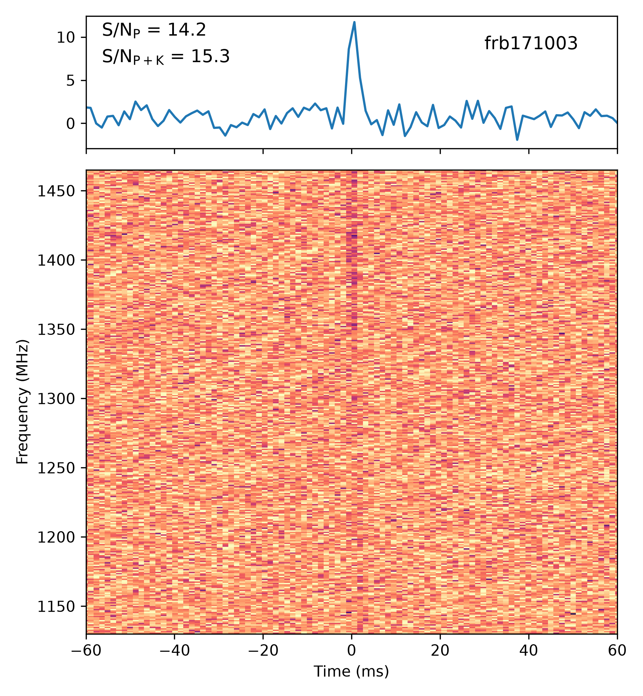
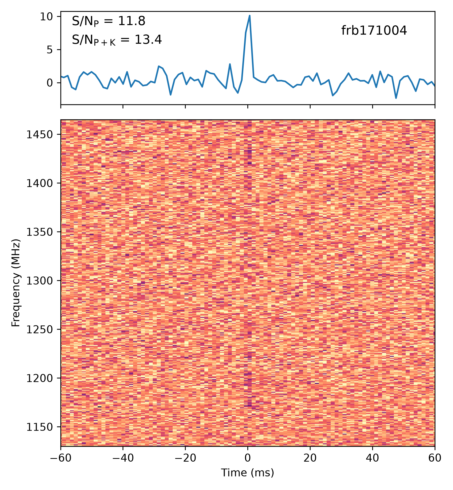

# kalman_detector

[](https://github.com/pravirkr/kalman_detector/actions/workflows/ci.yml)
[](https://codecov.io/gh/pravirkr/kalman_detector)
[](https://github.com/pravirkr/kalman_detector/blob/main/LICENSE)
[](https://pypi.org/project/kalman_detector/)
[](https://github.com/astral-sh/ruff)

A Python Implementation of a Kalman filter detector for detecting smoothly varying signals hidden in gaussian noise, such as Fast Radio Bursts (FRBs).

The detection statistic is designed to process `I(f)`, a sequence of observed "amplitudes" (where `f` is an arbitrary indexed parameter), and decide between the following hypotheses:

```markdown
H0: I(f) = N(f)         Pure gaussian noise
H1: I(f) = A(f) + N(f)  A(f) is a smooth gaussian process with an unknown smoothness parameter. 
```

## Installation

Python 3.12 or newer, on Linux or macOS.

```bash
pip install -U kalman_detector
```

`uv pip install kalman_detector` works the same way. Changes are listed in the [changelog](CHANGELOG.md).

## Development

Clone the repository and install the development environment with [uv](https://docs.astral.sh/uv/):

```bash
uv sync
uv run pytest
uv run pre-commit install
```

## Usage

```python
from kalman_detector.main import KalmanDetector
from kalman_detector.utils import SnrResult

kalman = KalmanDetector(spectrum_std)  # zero std flags a masked channel
kalman.prepare_fits()                  # analytic null, no Monte Carlo
sigs, scores = kalman.get_significance(spectrum)  # log p-value and score per q

# Combine with the box-car S/N, correcting for the choice of the best q.
result = SnrResult("burst", snr_box, kalman.get_best_significance(spectrum), n_eff=kalman.n_eff)
print(result.snr_kalman)
```

By default the detector uses the diffuse prior: the score is the likelihood ratio of the spectral contrast, which ignores a constant offset of the spectrum. `prepare_fits()` computes its null distribution analytically for any channel mask (tridiagonal eigenvalues and a saddlepoint tail, about 20 ms for 1024 channels and 8 values of q). `KalmanDetector(spectrum_std, diffuse=False)` with `prepare_fits(ntrials=10000, method="mc")` gives the Monte Carlo calibration of Kumar, Zackay & Law (2024).

Two optional checks for candidates from real data:

```python
# Compare the analytic null with the scores of off-pulse spectra (n_off, nchans),
# and anchor the significance to them.
anchor = kalman.off_pulse_anchor(off_pulse_spectra)
print(anchor.scale_ratio, anchor.mean_z)  # ~1 and ~N(0, 1) when the noise model holds
sigs, scores = kalman.get_significance(spectrum, off_pulse_spectra)

# Narrowband bursts: best subband S/N combined with its Kalman contrast,
# corrected for the number of subbands searched.
local = kalman.get_localized_significance(spectrum)
print(local.chan_start, local.chan_end, local.snr)
```

The anchor repairs a misestimated noise model, but it is slightly optimistic when the model is already right, so use it as a check. The localized significance gains most for bursts narrower than about 1/16 of the band, and loses a little for broadband bursts.

`kalman_detector.svm.kalman_binary_compress_diffuse` computes the same diffuse score with the binary-tree (FDMT-style) merge, for any number of channels and with masks. The moment-form tree of the 2024 paper (`kalman_filter_binary`, `svm.State`) is kept to reproduce that paper; it needs a power-of-two number of channels and no mask.

### Example

The [example script](examples/frb_kalman.py) scores the two included ASKAP bursts, prints the off-pulse check and the localized result, and plots the waterfall. It needs `h5py`, which is not installed with the package:

```bash
uv run --with h5py python examples/frb_kalman.py examples/frb171004.h5
```

|           |           |
| --------- | --------- |
|  |  |

### Efficiency

An example efficiency plot can be generated using:

```python
python -m kalman_detector.efficiency
```

## Citation

Please cite [Kumar, Zackay & Law (2024)](https://ui.adsabs.harvard.edu/abs/2024ApJ...960..128K) if you find this code useful in your research.
The BibTeX entry for the paper is:

```bash
@ARTICLE{2024ApJ...960..128K,
       author = {{Kumar}, Pravir and {Zackay}, Barak and {Law}, Casey J.},
        title = "{Detecting Fast Radio Bursts with Spectral Structure Using the Continuous Forward Algorithm}",
      journal = {\apj},
     keywords = {Radio astronomy, Radio transient sources, Astronomy data analysis, Astrostatistics techniques, Interstellar scintillation, 1338, 2008, 1858, 1886, 855, Astrophysics - High Energy Astrophysical Phenomena, Astrophysics - Instrumentation and Methods for Astrophysics},
         year = 2024,
        month = jan,
       volume = {960},
       number = {2},
          eid = {128},
        pages = {128},
          doi = {10.3847/1538-4357/ad0964},
archivePrefix = {arXiv},
       eprint = {2306.07914},
 primaryClass = {astro-ph.HE},
       adsurl = {https://ui.adsabs.harvard.edu/abs/2024ApJ...960..128K},
      adsnote = {Provided by the SAO/NASA Astrophysics Data System}
}
```
